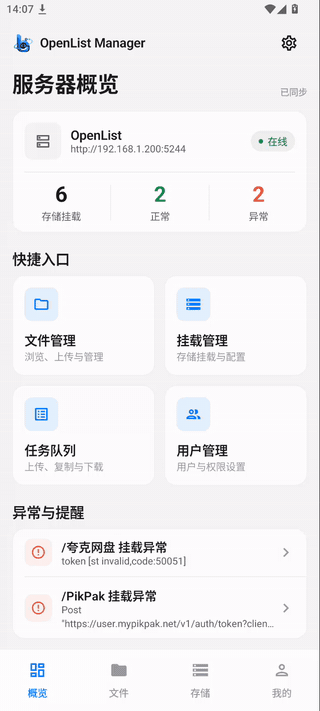
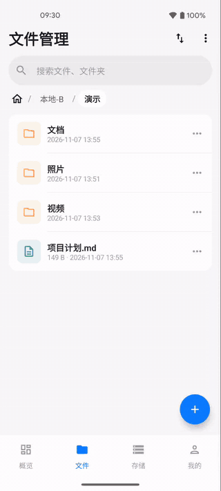
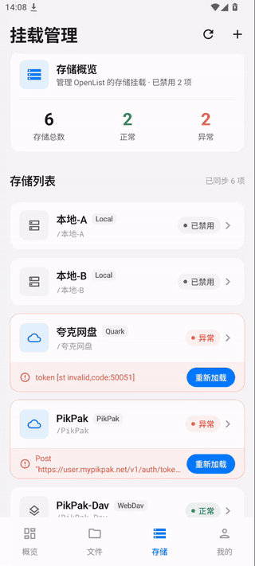
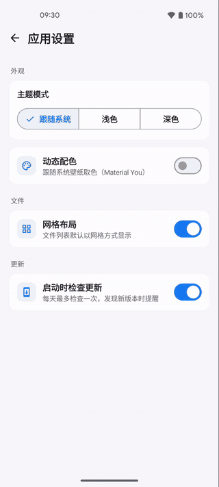

<div align="center">


# OpenList Manager

**OpenList 的 Android 远程管理客户端**

通过 OpenList 官方 REST API，在手机上管理文件、存储挂载、用户与任务。

[](LICENSE)
[](https://github.com/VarleyT/Openlist-Manager)
[](https://github.com/VarleyT/Openlist-Manager)
[](https://github.com/VarleyT/Openlist-Manager)
[](https://github.com/VarleyT/Openlist-Manager/commits/main)
[](https://github.com/VarleyT/Openlist-Manager/releases)
[](https://github.com/VarleyT/Openlist-Manager/stargazers)

[](https://developer.android.com)
[](https://kotlinlang.org)
[](https://developer.android.com/compose)
[](https://github.com/OpenListTeam/OpenList)

[功能特性](#-功能特性) · [界面预览](#-界面预览) · [快速开始](#-快速开始) · [从源码构建](#-从源码构建) · [安全说明](#-安全说明) · [许可证](#-许可证)

</div>

---

## 📖 简介

[OpenList](https://github.com/OpenListTeam/OpenList) 是一款支持多种网盘的文件列表程序。**OpenList Manager** 是为它打造的原生 Android 管理端：无需打开网页后台，即可在手机上完成日常的文件管理、存储挂载维护、用户权限配置与任务查看。

- 原生 Jetpack Compose 界面，深浅色双主题，支持 Material You 动态取色
- 已适配 OpenList v4 API
- 多服务器管理，认证信息加密保存、互相隔离

## ✨ 功能特性

| 模块 | 能力 |
|---|---|
| 📊 **服务器概览** | 在线状态、存储挂载统计（总数 / 正常 / 异常）、快捷入口、异常挂载提醒 |
| 📁 **文件管理** | 浏览目录、面包屑导航、列表 / 网格布局切换、多字段排序、搜索（需服务器开启索引）、上传、新建文件夹、重命名、复制、移动、删除 |
| 👀 **文件预览** | 图片双指缩放预览、文本 / 代码预览；其他格式可调用外部应用打开，支持下载与复制直链 |
| 🗄️ **挂载管理** | 存储列表与状态、启用 / 禁用、单个或全部重新加载、按驱动动态生成配置表单（字段名与说明已中文化） |
| 📋 **任务中心** | 上传、复制、移动、离线下载等任务，按状态与类型筛选 |
| 👥 **用户管理** | 新建 / 编辑 / 禁用 / 删除用户，角色、基础路径与细粒度权限设置，关闭两步验证 |
| ⚙️ **系统设置** | 按分组查看与修改 OpenList 站点全局配置 |
| 🔐 **登录与服务器** | 用户名密码登录，支持 2FA 验证码；多服务器添加、切换与移除 |
| 🎨 **外观** | 浅色 / 深色 / 跟随系统；Android 12+ 支持跟随壁纸取色 |

## 📸 界面预览

<table>
  <tr>
    <td align="center"><br/><b>服务器概览与导航</b></td>
    <td align="center"><br/><b>文件管理</b><br/><sub>目录浏览 · 网格 / 列表 · 排序 · 新建</sub></td>
  </tr>
  <tr>
    <td align="center"><br/><b>挂载管理</b><br/><sub>状态总览 · 异常重载 · 动态配置表单</sub></td>
    <td align="center"><br/><b>深色主题</b><br/><sub>浅色 / 深色 / 跟随系统</sub></td>
  </tr>
</table>

## 🚀 快速开始

### 环境要求

- Android **11（API 30）** 及以上设备
- 一台可访问的 **OpenList v4** 服务器
- 具备管理员权限的账号（挂载管理、用户管理、系统设置等功能需要管理员权限）

### 安装

1. 前往 [Releases](https://github.com/VarleyT/Openlist-Manager/releases) 下载最新 APK；
2. 在手机上安装（如提示“未知来源”，请在系统设置中允许）。

> 也可以参考下文 [从源码构建](#-从源码构建) 自行编译。

### 连接服务器

1. 打开应用，在登录页填写 **服务器地址**，例如 `https://nas.example.com` 或 `http://192.168.1.10:5244`；
2. 输入 **用户名** 与 **密码**；若账号开启了两步验证，再填写 **2FA 验证码**；
3. 点击登录，进入「服务器概览」。

之后可在「我的 → 服务器连接」中添加更多服务器并随时切换。

### 使用提示

- **搜索无结果 / 不可用**：需先在 OpenList 网页后台「索引」中开启并构建索引。
- **挂载显示异常**：在「挂载管理」中查看错误信息，修正配置后点击「重新加载」。
- **切换文件布局 / 动态配色**：「我的 → 应用设置」。

## 🛠️ 从源码构建

### 环境

| 工具 | 版本 |
|---|---|
| JDK | 17+ |
| Android Gradle Plugin | 9.5 |
| Gradle | 9.6（使用仓库自带 Wrapper） |
| Kotlin | 2.3 |
| compileSdk / targetSdk / minSdk | 37 / 36 / 30 |

推荐使用最新版 Android Studio 打开项目。

### 构建命令

```bash
git clone https://github.com/VarleyT/Openlist-Manager.git
cd Openlist-Manager

# Debug 包
./gradlew assembleDebug

# 单元测试
./gradlew testDebugUnitTest

# Release 包（需配置签名，见下文）
./gradlew assembleRelease
```

产物位于 `app/build/outputs/apk/`。

### Release 签名（可选）

在项目根目录创建 `keystore/` 目录（已被 `.gitignore` 忽略），放入签名文件并新建 `keystore/keystore.properties`：

```properties
storeFile=release.jks
storePassword=your_store_password
keyAlias=your_key_alias
keyPassword=your_key_password
```

未配置时 Release 包不会签名，不影响 Debug 构建。

## 🧱 技术栈

- **UI**：Jetpack Compose · Material 3 · Navigation Compose · SplashScreen
- **架构**：MVVM · 单 Activity · 按功能分包（`feature/*`）+ `core` / `data` 分层
- **依赖注入**：Hilt
- **网络**：Retrofit · OkHttp · Kotlinx Serialization
- **异步**：Kotlin Coroutines / Flow · WorkManager
- **存储**：DataStore Preferences · Android Keystore
- **图片**：Coil 3
- **测试**：JUnit · MockK · Turbine · MockWebServer

<details>
<summary>项目结构</summary>

```text
app/src/main/java/com/bytegrep/oplist_manager/
├── core/
│   ├── common/          # 通用工具
│   ├── datastore/       # 服务器配置与偏好存储
│   ├── designsystem/    # 主题与通用组件
│   ├── network/         # Retrofit / OkHttp 配置与 API 定义
│   └── security/        # Keystore 加解密
├── data/
│   ├── model/           # 数据模型
│   ├── repository/      # 仓库层
│   └── session/         # 会话管理
├── di/                  # Hilt 模块
├── feature/
│   ├── dashboard/       # 服务器概览
│   ├── files/           # 文件管理与预览
│   ├── login/           # 登录
│   ├── profile/         # 我的 / 应用设置 / 关于
│   ├── servers/         # 服务器连接
│   ├── settings/        # OpenList 系统设置
│   ├── storage/         # 挂载管理与动态表单
│   ├── tasks/           # 任务中心
│   └── users/           # 用户管理
└── navigation/          # 导航图与底部导航
```

</details>

## 🔒 安全说明

- Token 与密码使用 **Android Keystore（AES-256-GCM）** 加密保存，不参与云备份；
- 不同服务器之间的认证信息相互隔离，移除服务器时本机凭据一并删除；
- 仅信任系统 CA 证书，**不会忽略 TLS 证书错误**；
- 为兼容局域网部署允许 `http://` 访问，但 HTTP 为明文传输，登录页会给出风险提示，建议仅在可信局域网使用，公网访问请使用 HTTPS。

## 🤝 贡献

欢迎提交 Issue 与 Pull Request：

1. Fork 本仓库并创建分支：`git checkout -b feat/your-feature`
2. 提交修改：`git commit -m "feat: 描述你的改动"`（遵循 [Conventional Commits](https://www.conventionalcommits.org/zh-hans/)）
3. 推送并发起 Pull Request

## 🙏 致谢

- [OpenList](https://github.com/OpenListTeam/OpenList) —— 本项目所管理的服务端

## 📄 许可证

本项目基于 [MIT License](LICENSE) 开源。

> 本项目为第三方客户端，与 OpenList 官方无关联。
